# MOS prototype: architecture

Everything below describes what is built in this repository, with file paths so you can check it. Where a claim is
an assessment rather than something the code proves (section 8), it is marked as such.

**Contents**

1. [TL;DR](#1-tldr)
2. [Pain points and how the prototype solves them](#2-pain-points-and-how-the-prototype-solves-them)
3. [Why no git](#3-why-no-git)
4. [Lifecycle](#4-lifecycle)
5. [Data model](#5-data-model)
6. [Code storage](#6-code-storage)
7. [The development environment](#7-the-development-environment)
8. [Feasibility for production: lean embedded IDE vs a coupled VS Code](#8-feasibility-for-production-lean-embedded-ide-vs-a-coupled-vs-code)
9. [Bifrost (optional Jatayu target)](#9-bifrost-optional-jatayu-target)
10. [Security model](#10-security-model)
11. [Tech stack and dependencies](#11-tech-stack-and-dependencies)
12. [Repository map](#12-repository-map)
13. [Testing](#13-testing)
14. [Known limitations and next steps](#14-known-limitations-and-next-steps)

---

## 1. TL;DR

- **MOS** is a mission-operations system. A *procedure* is one Python file with one public, fully type-annotated entry
  function, driving a spacecraft through generated TM/TC classes (`import framework.ff.commands as comm`).
- **This prototype replaces git + PRs + laptops** with a web app: write in an embedded editor, dry-run against a mock
  spacecraft in the browser, submit a frozen **snapshot**, and move it through review, test and approval. Exactly one
  snapshot per procedure is *approved* (what PROD runs). Every move is audited.
- **The state machine lives in Postgres**, not in the UI: one `SECURITY DEFINER` function
  (`public.transition_snapshot`) checks roles, separation of duties, the allowed-move table and locks the procedure row,
  so two people can never produce two approved snapshots.
- **No code runs on a server.** Python runs in the browser (Pyodide/WebAssembly in Web Workers). The only server-side
  execution is the optional Bifrost runner for the Jatayu mission.
- **Built to get operator feedback**: seeded demo data (20 real Firefly procedures, 6 personas, realistic histories
  including a rollback incident), one-click persona login.

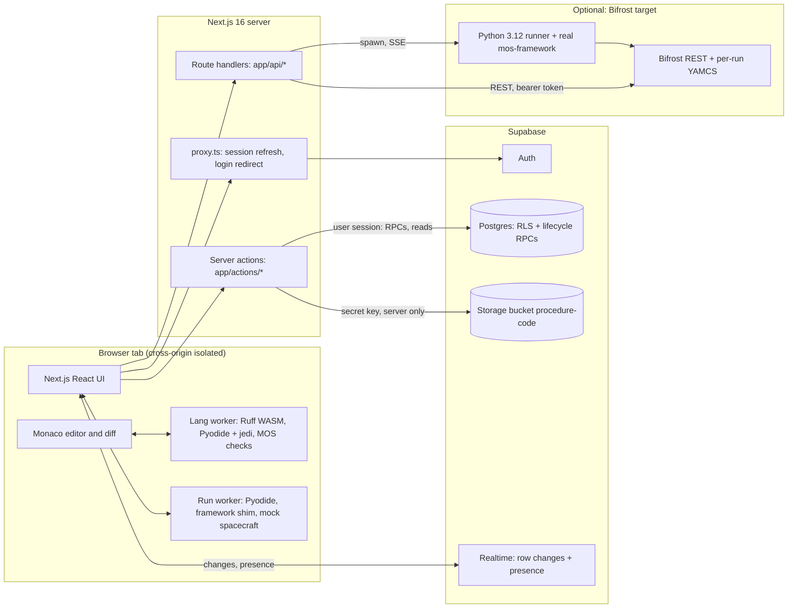

Source: `next.config.ts` (COOP/COEP headers), `proxy.ts`, `app/actions/`, `app/api/`, `workers/`, `supabase/migrations/`.

---

## 2. Pain points and how the prototype solves them

Pain points come from the PRDs (`prds/procedure-lifecycle-states.md` section 2, `prds/procedure-workspaces-and-environments.md`
section 2) and from how operators work today.

| # | Pain point today | Mechanism in this prototype | Where |
|---|---|---|---|
| 1 | Two reviewed PRs merge into a file nobody tested | Whole-file immutable snapshots; exactly one approved snapshot per procedure; approving a snapshot supersedes the previous one. No line merging exists. See [section 3](#3-why-no-git) | `snapshots`, `one_approved_per_procedure` index, `transition_snapshot` |
| 2 | Forgotten pushes, work lost on a laptop | Autosave to server storage (800 ms debounce, retry with backoff) plus a localStorage mirror used for recovery | `lib/ide/save-queue.ts`, `components/mos/ide/use-autosave.ts`, `lib/ide/storage.ts`, `saveDraft` in `app/actions/lifecycle.ts` |
| 3 | Laptop environment drift (deps, OS, Python version) | No local environment: everyone runs the same pinned Pyodide (`pyodide` 314.0.7, CPython 3.14.2) and the same shim files, versioned by a content hash | `package.json`, `scripts/vendor-assets.ts`, `public/py/manifest.json` (`hash`), `scripts/py-manifest.ts` |
| 4 | No record that a procedure was tested, by whom, on which version | `test_records` (case, result, notes, attached `runs` row) bound to a frozen snapshot; `runs` store args, options and the event timeline | `supabase/migrations/20261022000001_core_schema.sql`, `app/actions/collab.ts` (`addTestRecord`, `startRun`, `finishRun`) |
| 5 | PR approvals can arrive in any order | The forward path is enforced in the database: 2 to 3a to 4a to 5a; each step needs its own role | `transition_snapshot` (`case p_action ...`), mirrored for the UI in `lib/lifecycle.ts` (`ACTIONS`) |
| 6 | Failures are lost as closed PRs | Failure is a state (3b, 4b, 5b) with a mandatory comment, kept in `state_transitions`; a failed snapshot is never edited, the fix is a new snapshot; 4b and 5b can be retested | `transition_snapshot` (`v_needs_comment`), `/audit` |
| 7 | Cannot tell what is cleared for flight | `procedures.active_snapshot_id` + partial unique index; PROD lane on the procedure page; "In PROD now" on every snapshot page; `procedure_overview` view | `components/mos/procedure/where-is-it.tsx`, view `procedure_overview` |
| 8 | Taking a bad procedure out of use is slow (revert PR through the full flow) | Rollback = reactivate an earlier snapshot (approver, comment, no review cycle). Withdraw via a guided "reactivate another, then withdraw" flow. Retire/restore a whole procedure | `transition_snapshot`, `app/(app)/snapshots/[id]/_components/withdraw-flow.tsx`, `set_procedure_retired` |
| 9 | Work stalls unnoticed | Per-role queues (`QUEUE_STATES`), stale badge after 5 days (`STALE_AFTER_DAYS`), `last_activity_at` in `procedure_overview` | `lib/lifecycle.ts`, `lib/data/queue.ts`, `app/(app)/_home/` |
| 10 | Hand-maintained procedure registry (`ff-procedures/ops/procedures/__init__.py` is 2,216 lines) | Procedures are rows (`procedures`: name, mission, folder, description). Creating one is a dialog; nothing to edit by hand | `create_procedure`, `components/mos/procedure/new-procedure-dialog.tsx` |
| 11 | Interactive terminal prompts (`inquirer`) block procedures | The framework shim turns every prompt into a UI event and blocks the worker on `Atomics.wait` until the operator clicks (keys 1-9 also work) | `public/py/framework/mdb/super_class.py` (`_ask`), `workers/run.worker.ts` (`bridge.prompt`), `components/mos/ide/prompt-banner.tsx` |
| 12 | No dry run, no simulator at hand | Mock spacecraft with virtual clock (time warp 1x, 10x, 100x, instant), telemetry store, command effects, fault injection and a live inspector | `public/py/mos_sim/`, `public/sim/ff-sim.json`, `components/mos/ide/run-panel.tsx`, `faults-builder.tsx`, `inspector.tsx` |
| 13 | No linting or static checks | Ruff (WASM), 10 MOS rules (MOS000 to MOS009) and catalog diagnostics (unknown command, parameter, enum member, missing or pre-assigned argument). Errors block submit | `workers/lang.worker.ts`, `public/py/mos_lint/check.py`, `lib/editor/catalog-analysis.ts`, `components/mos/ide/submit-dialog.tsx` |
| 14 | A 7 MB generated TM/TC library (`commands.py` + `parameters.py`) | A 1.8 MB JSON catalog (about 89 KB brotli) feeds editor completions and the run worker, which builds classes lazily (PEP 562 `__getattr__`). No giant stub files | `public/catalog/ff.json`, `scripts/build_catalog.py`, `public/py/framework/_catalog.py` |
| 15 | Collisions between operators editing the same procedure | Per-author working copies (`create_working_copy`), only the author can write one; Realtime presence per procedure shows who else is in it; fork any snapshot | `components/mos/ide/use-presence.ts` (channel `procedure:<id>`), `lib/ide/presence.ts`, `saveDraft` author check |
| 16 | Nobody can say afterwards who reviewed, tested, cleared | Append-only `state_transitions` (user, time, from, to, comment, evidence) and `procedure_events`; incident lookup answers "which version ran at time T, who cleared it" | `private.reject_mutation` triggers, `/audit` incident form (`app/(app)/audit/_components/incident-form.tsx`), CSV export `app/api/audit/export/route.ts` |
| 17 | Approved code can be edited after sign-off | Frozen code is a separate storage object whose key contains its sha256; reads re-hash and show "SHA-256 verified" | `lib/storage.ts` (`readSnapshotCode`), `app/(app)/snapshots/[id]/_components/header.tsx` |
| 18 | Authors approving their own work | Separation of duties inside the RPC (toggle `allow_self_actions` for solo demos) | `transition_snapshot`, `app/(app)/admin/_components/self-actions-card.tsx` |
| 19 | Two people act on the same snapshot at once (flagged as a gap in PRD-001 section 11) | Procedure row is locked `FOR UPDATE`; first write wins; the second sees the new state and is refused | `transition_snapshot`, concurrency scenario in `scripts/db-test.ts` |

---

## 3. Why no git

Git merges *lines*. Reviews and tests approve *files*. The gap between the two is where untested combinations appear.

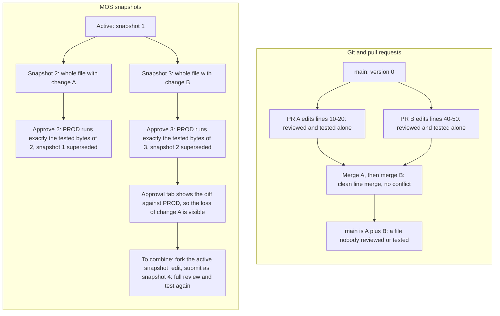

| | Git + PR | MOS |
|---|---|---|
| Unit of review and test | A diff (lines) | A whole file, frozen, hashed |
| What reaches PROD | Whatever the merge produced | Exactly the snapshot that was approved |
| Combining two changes | Automatic line merge | Explicit: fork the active snapshot, edit, resubmit, re-review, re-test |
| Several versions "ready" at once | Several open PRs, order decides | Several snapshots may be in the pipeline; **at most one is approved** (`one_approved_per_procedure`) |
| Approving a stale branch | Possible (the branch may revert newer work silently) | Approval tab shows "What changes in PROD" and offers a diff against the active snapshot (`approval-tab.tsx`, `ProdImpact`) |
| Lineage | Commit graph | `snapshots.parent_snapshot_id` ("forked from"), shown in `components/mos/procedure/snapshot-lineage.tsx` |

Consequences: no merge conflicts, no rebases, no branches to name, no credentials on laptops. The cost is that
combining work is a deliberate, reviewed act; for single-file procedures with one owner that is the behaviour
operators want.

---

## 4. Lifecycle

Snapshot states are the enum `public.snapshot_state` (10 values). The PRD numbering (1, 2, 3a, ...) is carried in
`lib/lifecycle.ts` (`STATE_META[...].code`). *Retired* (6) is a procedure-level flag, not a snapshot state.

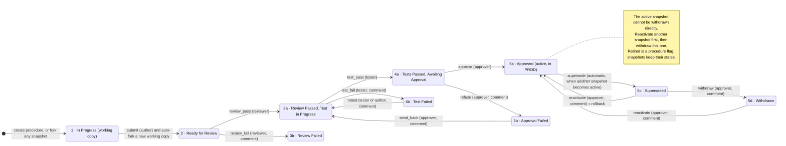

### Allowed moves (authoritative source: `public.transition_snapshot`, `supabase/migrations/20261022000001_core_schema.sql`)

| Action | From | To | Who | Comment required |
|---|---|---|---|---|
| `create` (`create_procedure`, `create_working_copy`) | none | 1 `in_progress` | author | no |
| `submit` (`submit_snapshot`) | 1 | 2 `ready_for_review` | the snapshot's author | change summary required |
| `review_pass` | 2 | 3a `test_in_progress` | reviewer | no |
| `review_fail` | 2 | 3b `review_failed` | reviewer | yes |
| `test_pass` | 3a | 4a `approval_pending` | tester | no |
| `test_fail` | 3a | 4b `test_failed` | tester | yes |
| `retest` | 4b | 3a | tester **or the snapshot's author** | yes |
| `approve` | 4a | 5a `approved` | approver | no |
| `refuse` | 4a | 5b `approval_failed` | approver | yes |
| `send_back` | 5b | 3a | approver | yes |
| `supersede` | 5a | 5c `superseded` | system (logged with the approving user as actor) | automatic |
| `reactivate` | 5c or 5d | 5a | approver | yes |
| `withdraw` | 5c | 5d `withdrawn` | approver | yes |
| retire / restore (`set_procedure_retired`) | procedure flag | | approver | reason required |

`admin` satisfies every role check (`private.has_role`). 3b is terminal: no action leaves it (PRD R4).

### Rules that go beyond the PRD's state table

| Rule | Implementation |
|---|---|
| **Separation of duties** | Unless `app_settings.allow_self_actions` is true: the author cannot `review_pass`, `review_fail`, `test_pass`, `test_fail`, `approve` or `refuse` their own snapshot; whoever did `review_pass` cannot `approve` or `refuse` it. Error text: "You cannot review your own snapshot" / "You reviewed this snapshot, so someone else must approve it". |
| **Withdraw rule (the user's rule)** | The active snapshot (5a) cannot be withdrawn directly (`withdraw` only accepts 5c). To take the active one out of PROD: reactivate another snapshot (which supersedes the active one), then withdraw the superseded one. The UI does both as one guided dialog, recording two audit rows plus the automatic supersede row. If no earlier snapshot exists, the dialog says there is nothing to fall back to and points to retiring the procedure. |
| **Auto-fork on submit** | `submit_snapshot(..., p_fork => true)` freezes the row and, in the same transaction, creates a new `in_progress` snapshot (`parent_snapshot_id` = the submitted one) so the author keeps editing (PRD goal 5). The submit dialog has a checkbox to skip it. The server copies the frozen text into the new draft. |
| **Rollback semantics** | `reactivate` makes the target active and supersedes the current active snapshot in the same transaction. The supersede row's comment reads "Rolled back: #N reactivated in place of #M"; `related_snapshot_id` links the two. No review or test is repeated (PRD R6c). |
| **Retired procedures** | Every lifecycle RPC refuses with "This procedure is retired. Restore it first." Snapshots keep their states; restoring brings the approved one back (PRD A14/A15). |
| **Failure comments** | `review_fail`, `test_fail`, `retest`, `refuse`, `send_back`, `reactivate`, `withdraw` all require a non-blank comment (`22023`). |

### Concurrency

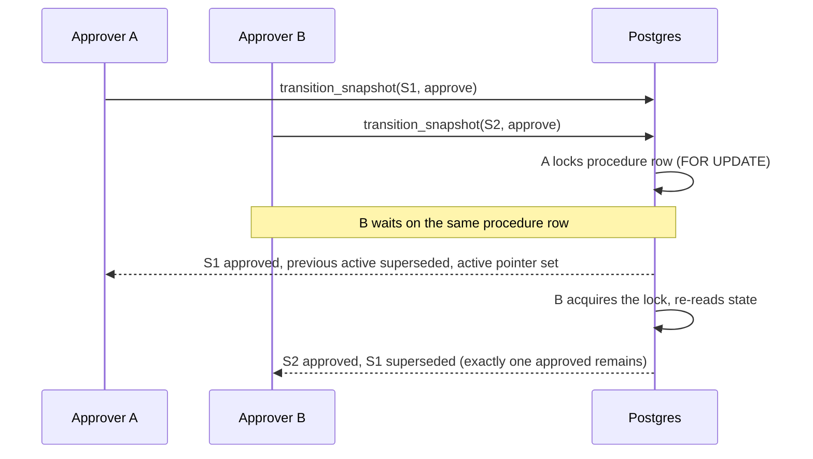

- `transition_snapshot` locks the **procedure row** first, then the snapshot row. Moves on any snapshot of one procedure
  serialize; first write wins and the loser re-evaluates against fresh state (and is refused if the move is no longer legal).
- `create index one_approved_per_procedure on snapshots (procedure_id) where state = 'approved'` is the backstop: even a
  direct write cannot make a second approved row (tested in `scripts/db-test.ts`).
- `procedures.active_snapshot_id` is only written by the lifecycle functions; `verify_lifecycle_integrity()` detects drift.

---

## 5. Data model

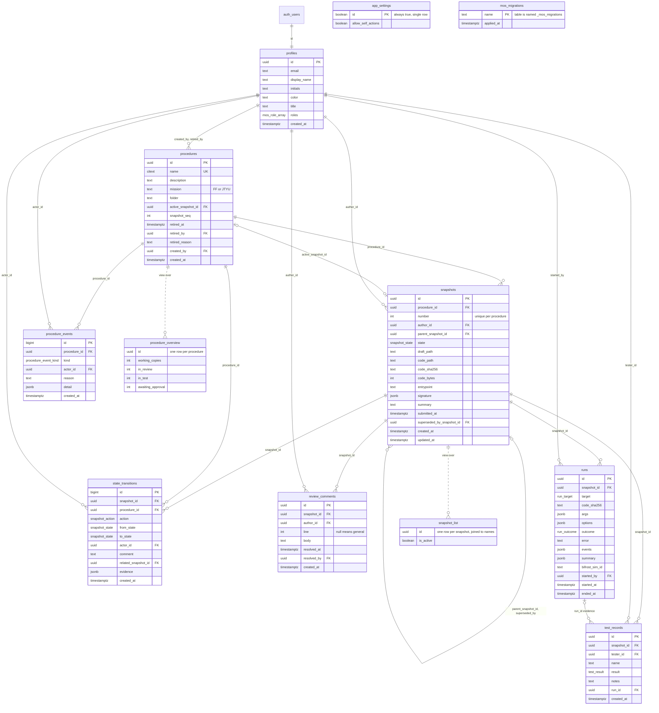

Enums: `mos_role` (author, reviewer, tester, approver, admin), `snapshot_state` (10 values above),
`snapshot_action` (create, submit, review_pass, review_fail, test_pass, test_fail, retest, approve, refuse, send_back,
supersede, reactivate, withdraw), `procedure_event_kind` (created, retired, restored, working_copy_discarded),
`test_result` (pass, fail, blocked), `run_target` (mock, bifrost), `run_outcome` (running, completed, skipped, stopped,
choose, error).

Migrations: `supabase/migrations/20261022000001_core_schema.sql` (everything) and `20261022000002_tighten_privileges.sql`
(revokes default DML grants). Applied by `npm run db:setup` (`scripts/db-setup.ts`), which records them in `_mos_migrations`.

### Tables

**`profiles`**: MOS users. Created automatically by trigger `on_auth_user_created` -> `private.handle_new_user()` when a
Supabase Auth user appears. Roles live here, not in the JWT, so a role change applies on the next request.

| Column | Type | Description |
|---|---|---|
| `id` | uuid PK | = `auth.users.id`, `on delete cascade` |
| `email` | text | Sign-in email |
| `display_name`, `initials` | text | Shown in avatars and the audit trail |
| `color` | text, default `#6366f1` | Avatar colour |
| `title` | text, null | Job title |
| `roles` | `mos_role[]`, default `{author}` | Granted roles |
| `created_at` | timestamptz | |

**`app_settings`**: single-row table (`id boolean primary key default true check (id)`).

| Column | Type | Description |
|---|---|---|
| `id` | boolean PK | Always `true`; guarantees one row |
| `allow_self_actions` | boolean, default false | Solo-demo switch that disables separation of duties. Toggled by an admin on `/admin` (`set_allow_self_actions`) |

**`procedures`**

| Column | Type | Description |
|---|---|---|
| `id` | uuid PK | |
| `name` | citext, unique, 3-120 chars | Case-insensitively unique procedure name (e.g. `FF_AXX_FCP_EPS_181_...`) |
| `description` | text, default `''` | |
| `mission` | text, `FF` or `JTYU` | Which catalog and which simulator apply |
| `folder` | text, default `''` | Display grouping such as `EPS/FCP` |
| `active_snapshot_id` | uuid, null, FK `snapshots` | The approved snapshot (5a). Written only by lifecycle functions |
| `snapshot_seq` | int, default 0 | Last per-procedure number handed out; gives #1, #2, ... |
| `retired_at`, `retired_by`, `retired_reason` | timestamptz / uuid FK / text | Retired flag (state 6); all null when active |
| `created_by`, `created_at` | uuid FK / timestamptz | |

Indexes: `procedures_created_by_idx`, `procedures_active_idx`. FK `procedures_active_snapshot_fk` is added after `snapshots` exists.

**`snapshots`**: one row per working copy / snapshot. Rows are never deleted except a never-submitted working copy
(`discard_working_copy`).

| Column | Type | Description |
|---|---|---|
| `id` | uuid PK | |
| `procedure_id` | uuid FK, cascade | |
| `number` | int | Per-procedure counter; `unique (procedure_id, number)` |
| `author_id` | uuid FK `profiles` | Owner of the working copy; the only one who can edit or submit it |
| `parent_snapshot_id` | uuid, null, FK self | Forked from (lineage) |
| `state` | `snapshot_state`, default `in_progress` | Current state |
| `draft_path` | text | Storage key `drafts/<id>.py` of the editable copy, set at creation |
| `code_path` | text, null | Storage key `frozen/<procedure_id>/<id>-<sha256>.py`, set on submit |
| `code_sha256` | text, null, check `^[0-9a-f]{64}$` | Hash of the frozen bytes |
| `code_bytes` | int, null | Frozen size |
| `entrypoint` | text, null | Entry function name captured at submit |
| `signature` | jsonb, null | Entry arguments and types captured at submit (drives the Run form) |
| `summary` | text, null | Required change note at submit |
| `submitted_at` | timestamptz, null | |
| `superseded_by_snapshot_id` | uuid, null, FK self | Which snapshot replaced it |
| `created_at`, `updated_at` | timestamptz | `updated_at` is touched by autosave and by transitions |

Constraints and indexes: `frozen_has_code` (`state = 'in_progress'` or both `code_path` and `code_sha256` set);
**`one_approved_per_procedure`** (unique partial index on `procedure_id where state = 'approved'`);
`snapshots_procedure_idx (procedure_id, number desc)`, `snapshots_state_idx`, `snapshots_author_idx`, `snapshots_parent_idx`.

**`state_transitions`**: append-only audit of every snapshot state change (PRD R8).

| Column | Type | Description |
|---|---|---|
| `id` | bigint identity PK | Orders events with `created_at` |
| `snapshot_id`, `procedure_id` | uuid FK, cascade | |
| `action` | `snapshot_action` | What was done |
| `from_state` | `snapshot_state`, null | Null for `create` |
| `to_state` | `snapshot_state` | |
| `actor_id` | uuid FK | Who. For the automatic `supersede` row this is the approving user |
| `comment` | text, null | Reason, or the submit summary |
| `related_snapshot_id` | uuid, null, FK | `supersede`: the snapshot that took over. `reactivate`/`approve`: the snapshot that was active before. `create`: the parent |
| `evidence` | jsonb, default `{}` | Free-form evidence passed by the UI (test cases, run ids) |
| `created_at` | timestamptz | |

Indexes: `transitions_snapshot_idx`, `transitions_procedure_idx`, `transitions_created_idx`, `transitions_actor_idx`.
Trigger `state_transitions_append_only` (`before update or delete`) raises `state_transitions is append-only`.

**`procedure_events`**: append-only audit of procedure-level events.

| Column | Type | Description |
|---|---|---|
| `id` | bigint identity PK | |
| `procedure_id` | uuid FK, cascade | |
| `kind` | `procedure_event_kind` | `created`, `retired`, `restored`, `working_copy_discarded` |
| `actor_id` | uuid FK | |
| `reason` | text, null | Required for retire/restore |
| `detail` | jsonb | e.g. the active snapshot at the time, or the discarded number |
| `created_at` | timestamptz | |

Index `procedure_events_procedure_idx`; trigger `procedure_events_append_only`.

**`review_comments`**

| Column | Type | Description |
|---|---|---|
| `id` | uuid PK | |
| `snapshot_id` | uuid FK, cascade | |
| `author_id` | uuid FK, default `auth.uid()` | |
| `line` | int, null, check `> 0` | Line in the frozen text; null = general comment. Stable because snapshots never change |
| `body` | text, non-empty | |
| `resolved_at`, `resolved_by` | timestamptz / uuid FK | |
| `created_at` | timestamptz | |

**`test_records`**

| Column | Type | Description |
|---|---|---|
| `id` | uuid PK | |
| `snapshot_id` | uuid FK, cascade | |
| `tester_id` | uuid FK, default `auth.uid()` | |
| `name` | text, non-empty | Test case name |
| `result` | `test_result` | `pass`, `fail`, `blocked` |
| `notes` | text, default `''` | |
| `run_id` | uuid, null, FK `runs`, `on delete set null` | Dry run attached as evidence |
| `created_at` | timestamptz | |

**`runs`**: dry runs (mock spacecraft or Bifrost).

| Column | Type | Description |
|---|---|---|
| `id` | uuid PK | |
| `snapshot_id` | uuid FK, cascade | Which snapshot (or working copy) was run |
| `target` | `run_target`, default `mock` | |
| `code_sha256` | text, null | Hash of the code that was run |
| `args`, `options` | jsonb | Argument values; warp, faults, seed |
| `outcome` | `run_outcome`, default `running` | |
| `error` | text, null | |
| `events` | jsonb, default `[]` | Timeline (the app stores the last 3000 events: `finishRun`) |
| `summary` | jsonb | Counts, virtual seconds, wall time |
| `bifrost_sim_id` | text, null | Simulation used when `target = 'bifrost'` |
| `started_by` | uuid FK, default `auth.uid()` | |
| `started_at`, `ended_at` | timestamptz | |

Index `runs_snapshot_idx (snapshot_id, started_at desc)`.

**`_mos_migrations`**: bookkeeping created by `scripts/db-setup.ts` (not by a migration): `name text primary key`,
`applied_at timestamptz`. RLS on, no policies, privileges revoked from `anon`/`authenticated`.

### Views (both `security_invoker = true`, so RLS applies to the caller)

| View | Purpose | Notable columns |
|---|---|---|
| `procedure_overview` | One row per procedure for lists (PRD R9) | `active_snapshot_id`, `active_number`, `active_sha256`, `active_since`, `working_copies`, `in_review`, `in_test`, `awaiting_approval`, `total_snapshots`, `last_activity_at`, retired columns |
| `snapshot_list` | One row per snapshot with names resolved, for the explorer table | `procedure_name`, `mission`, `folder`, `state`, `parent_number`, `author_name/initials/color`, `state_changed_at`, `is_active` |

### RLS and grants

| Object | `authenticated` can | Everyone else |
|---|---|---|
| All tables | `select` everything (policies `read ...` with `using (true)`: transparency) | `anon`: nothing (`revoke all` + no policies) |
| `procedures`, `snapshots`, `state_transitions`, `procedure_events`, `profiles`, `app_settings` | **no direct writes** (DML revoked in `20261022000002`); writes only through RPCs | `service_role` has all (seed, tests) |
| `review_comments` | `insert` as yourself, only on a snapshot that is not `in_progress`; `update` (resolve) if you wrote it or hold the reviewer role | |
| `runs` | `insert`/`update` only rows with `started_by = auth.uid()` | |
| `test_records` | `insert` only if tester role, `tester_id = auth.uid()` and the snapshot is `test_in_progress`; no update, no delete | |
| Functions in `public` | `execute` only on the listed RPCs; `public` and `anon` revoked | `reset_demo_data()` revoked from `authenticated`, `service_role` only |
| Functions in `private` | `has_role` only (needed by policies); the rest `service_role` | |
| Storage bucket `procedure-code` | nothing (no `storage.objects` policies); only the server with the secret key | |

Default privileges for future tables are also revoked (`alter default privileges ... revoke insert, update, delete, ...`).

### RPC catalogue (all `SECURITY DEFINER`, `search_path = ''`)

| Function | Who may call | What it does |
|---|---|---|
| `create_procedure(name, description, mission, folder)` | author | Inserts the procedure, a `created` event and working copy #1; returns ids and the draft path. Duplicate name -> "already exists" |
| `create_working_copy(procedure_id, parent_snapshot_id)` | author | Locks the procedure, refuses if retired, creates a new `in_progress` snapshot (parent optional); returns the parent's source path so the server can copy the bytes |
| `discard_working_copy(snapshot_id)` | the snapshot's author | Deletes a never-submitted working copy that nobody forked from; writes a `working_copy_discarded` event; only this path may delete its `create` transition row (`mos.discarding_working_copy`) |
| `submit_snapshot(id, summary, code_path, sha256, bytes, entrypoint, signature, fork)` | the snapshot's author | Validates state, summary, that `code_path` equals `frozen/<procedure>/<id>-<sha>.py` and that the storage object exists; logs `submit`; freezes the row; optionally forks (see section 6) |
| `transition_snapshot(id, action, comment, evidence)` | role per action (table in section 4) | All other lifecycle moves, with locking, separation of duties and atomic supersede/rollback |
| `set_procedure_retired(procedure_id, retired, reason)` | approver (or admin) | Sets/clears the retired flag and writes `retired`/`restored` event |
| `set_user_roles(user_id, roles)` | admin | Replaces `profiles.roles` |
| `set_allow_self_actions(allow)` | admin | Updates `app_settings` |
| `verify_lifecycle_integrity()` | authenticated (read-only) | Returns problems: active pointer not approved, approved snapshot without pointer, snapshot state differing from its last transition. Empty set = healthy. Used by tests and the seed script |
| `reset_demo_data()` | service role only | Truncates the demo tables (used by `npm run db:seed`) |

Private helpers: `has_role`, `require_role`, `self_actions_allowed`, `log_transition`, `new_snapshot`, `reject_mutation`,
`handle_new_user`, `reset_demo_data`.

### Append-only enforcement

`private.reject_mutation()` is a `before update or delete` row trigger on `state_transitions` and `procedure_events`.
It raises `P0001 ... is append-only`, except for `DELETE` while the transaction-local setting
`mos.discarding_working_copy = 'on'` (set only inside `discard_working_copy`). Even the table owner is blocked unless
the trigger is disabled. `scripts/db-test.ts` verifies updates, deletes and direct client writes are refused.

---

## 6. Code storage

Procedure source is not in Postgres. It lives in a private Storage bucket, reachable only from the Next.js server
(`lib/storage.ts`, using `lib/supabase/admin.ts` with the secret key). The browser never talks to Storage.

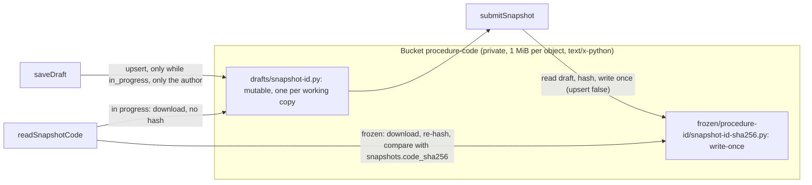

| Concept | Detail |
|---|---|
| Draft key | `drafts/<snapshot_id>.py`, assigned by `private.new_snapshot` at creation (`snapshots.draft_path`) |
| Frozen key | `frozen/<procedure_id>/<snapshot_id>-<sha256>.py` (`frozenPath` in `lib/storage.ts`). The content hash is part of the key |
| Size limits | Bucket 1 MiB per object; `saveDraft` rejects more than 512,000 characters (500 KB) |
| Who can reach it | Server only. Permission checks happen before each call: `saveDraft` and `submitSnapshot` read the snapshot through the user's RLS session and compare `author_id`; readers get paths from RLS-scoped queries |

**Why a late autosave cannot alter a frozen snapshot.** Autosave writes only `snapshots.draft_path`, and `saveDraft`
first checks `state = 'in_progress'`. Freezing writes a *different* object whose key contains the hash, with
`upsert: false`, so it can never be overwritten. After `submit_snapshot` commits, the row's state is no longer
`in_progress`, so further autosaves are refused ("This snapshot is frozen"); an autosave that raced the freeze can
only change the old draft, never `code_path`. The auto-forked working copy receives the *frozen text* as its draft.

**Verification on read.** `readSnapshotCode` returns `verified = sha256(code) === snapshots.code_sha256` for frozen
snapshots; the snapshot header shows "SHA-256 verified" (or a warning). The Bifrost run route refuses to run code that
fails verification (`app/api/bifrost/runs/route.ts`). The RPC checks that the path matches the expected pattern and that
the object exists, but Postgres cannot recompute the hash of a storage object; integrity therefore rests on the server
computing the hash, the hash being in the key, and the re-hash on every read.

### Sequence: autosave

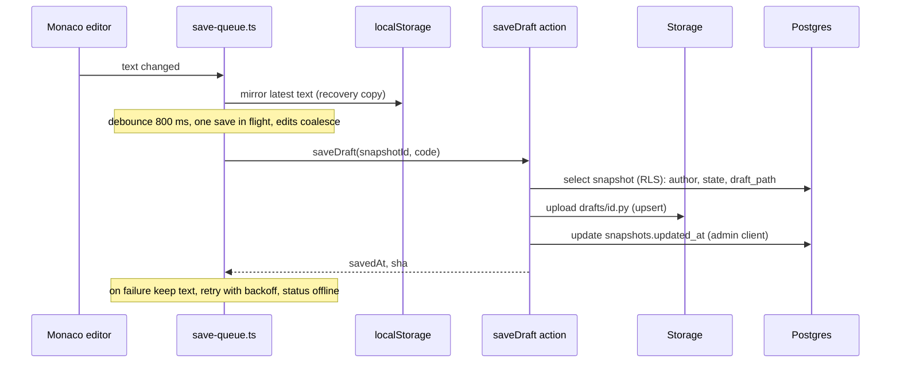

### Sequence: submit (freeze, RPC, fork)

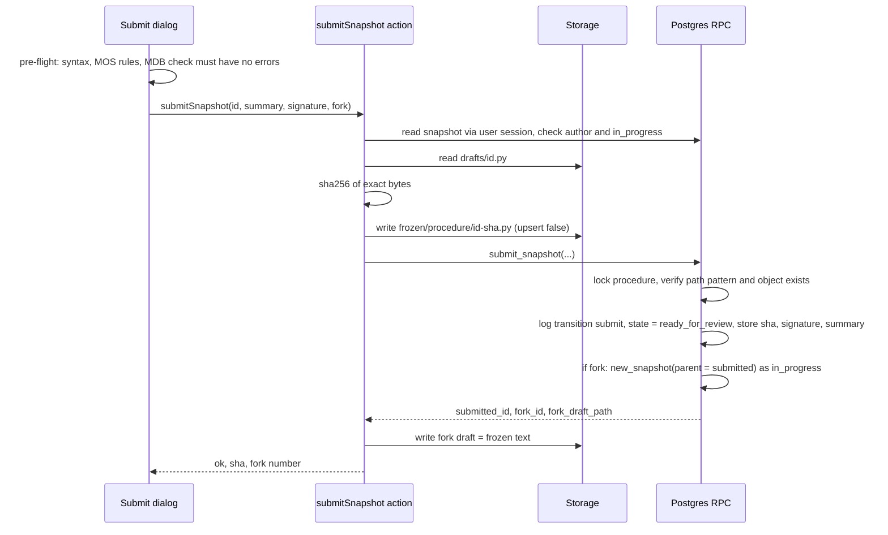

### Sequence: review, test, approve

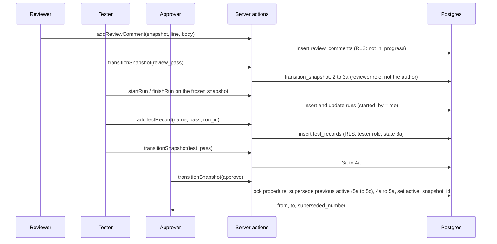

### Sequence: rollback and withdraw

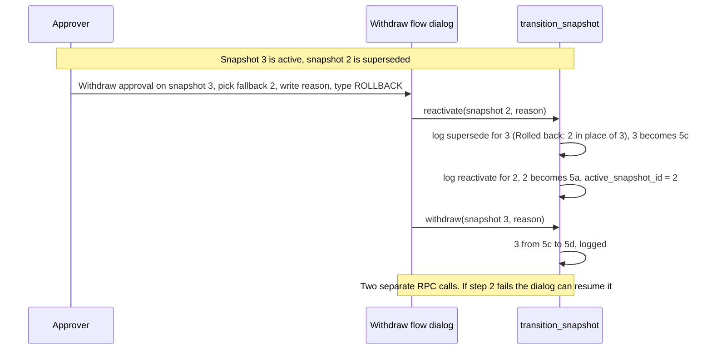

A plain rollback is just step 1 (the "Reactivate (rollback)" action on any superseded or withdrawn snapshot).

### Sequence: retire and restore

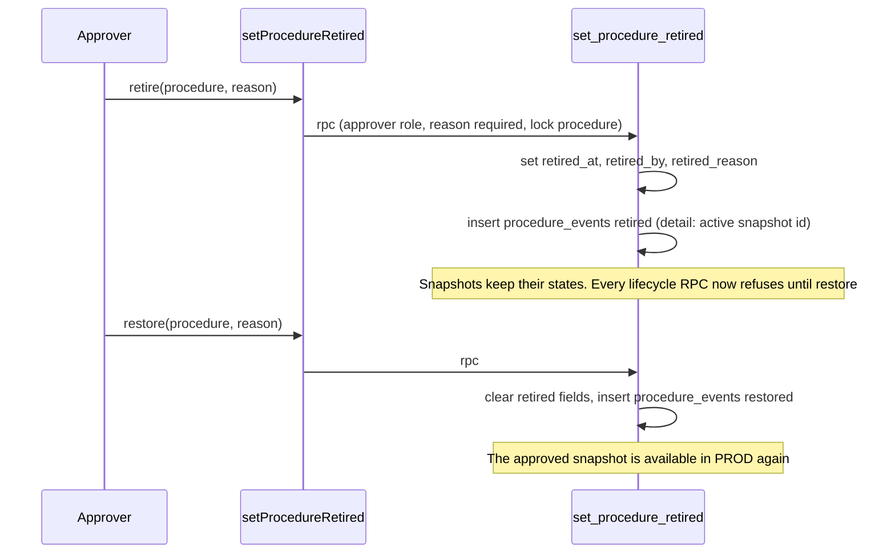

---

## 7. The development environment

The IDE is the centerpiece: a Monaco-based editor with catalog-aware intellisense, linting, a dry-run console and a
mock spacecraft, all inside the page. No server executes operator Python.

### Components

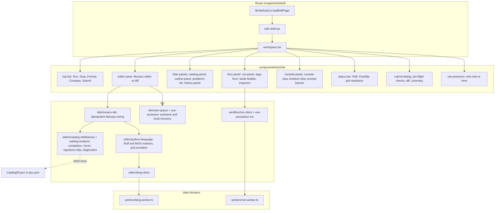

Shortcuts (`components/mos/ide/shortcuts-popover.tsx`): Cmd+Enter run, Cmd+. stop, Cmd+S format and save now,
Cmd+Space suggestions, keys 1-9 answer a prompt.

### The catalog: 7.3 MB of Python becomes 1.8 MB of JSON

| | Real `mos-framework` (FF) | MOS prototype |
|---|---|---|
| Representation | `framework/ff/commands.py` (4.47 MB) + `parameters.py` (2.89 MB) = **7.35 MB** of generated Python | `public/catalog/ff.json`: **1.79 MB** JSON (**about 89 KB** brotli, 138 KB gzip) |
| Content | Pydantic classes per command/parameter | **1,748 commands, 3,890 parameters, 392 enums** (176 command enums + 216 parameter enums); 5,422 command arguments |
| Built by | `datamodel-code-generator` | `scripts/build_catalog.py`: parses the generated modules with `ast` (nothing imported or executed). Source recorded in the file: `mos-framework @ 7379fb46 (generated 2026-04-21)` |
| Used by | Python import | Editor providers (main thread, instant) **and** the run worker's lazy modules |
| JTYU | n/a | `public/catalog/jtyu.json`: 1,183 commands, 1,997 parameters, 86 enums (generated from a live Bifrost MDB, section 9) |

### Editor intelligence: three layers

| Layer | Runs where | Gives | Files |
|---|---|---|---|
| **Catalog providers** | main thread, pure TS, no worker round trip | `comm.` / `param.` completion, keyword-argument and enum-value completion, hover cards, signature help, diagnostics `unknown-command`, `unknown-parameter`, `unknown-enum-member`, `invalid-enum-value`, `unknown-argument`, `preassigned-argument` (warning), `missing-argument` (warning), and "did you mean" quick fixes. Problems panel label: "MDB" | `lib/editor/catalog-analysis.ts` (1,033 lines, monaco-free, unit-tested), `catalog-intellisense.ts`, `catalog-docs.ts`, `mos-methods.ts` (method docs mirroring `SuperCommand`/`SuperParameter`) |
| **Ruff** (WASM) | lang worker | Lint (`E F W B UP`, target py312, 120 cols, noisy rules ignored) and formatting; quick fixes | `lib/editor/ruff-settings.ts`, `workers/lang.worker.ts` |
| **MOS checks + jedi** | lang worker (Pyodide) | MOS rules below; general Python completion, hover, signature, go-to-definition (same file) | `public/py/mos_lint/check.py`, `public/py/mos_lint/intel.py` |

Load order in the lang worker: Ruff first (so squiggles appear within a couple of seconds), then Pyodide + `mos_lint`,
then `jedi`/`parso` + the framework shim. Ruff requests never wait for Pyodide; only the most recent request of each
type is answered. The status bar shows each component's readiness.

**MOS rules** (`public/py/mos_lint/check.py`, Python `ast`; errors block submit):

| Code | Severity | Rule |
|---|---|---|
| MOS000 | error | Syntax error |
| MOS001 | error | No public top-level function (the entry point) |
| MOS002 | error | More than one public top-level function |
| MOS003 | error | Entry argument without type annotation |
| MOS004 | error | Unsupported annotation (supported: `str`, `int`, `float`, `bool`, `datetime`, `list[...]`, framework enums); also `*args` / `**kwargs` |
| MOS005 | error | Import not allowed. Allowlist: `framework.*` plus `operator, time, datetime, math, re, json, enum, typing, dataclasses, collections, itertools, functools, statistics, random, string, textwrap, copy, decimal, fractions, logging`. Tailored messages for `os`, `sys`, `subprocess`, `requests`, `pandas`, `inquirer`, Slack/Jira/Google clients, and cross-procedure helper imports (`utils`, `src`, `ops`, `yamcs_utils`) |
| MOS006 | error | Forbidden call: `input`, `exec`, `eval`, `__import__`, `os.system`, `os.popen`, `subprocess.*` |
| MOS007 | warning | File access (`open`, file writes) or absolute / home-relative path literal |
| MOS008 | warning | `MISSION` constant does not match the procedure's mission |
| MOS009 | info | `time.sleep` with a literal longer than 600 s |

### Run worker, framework shim and mock spacecraft

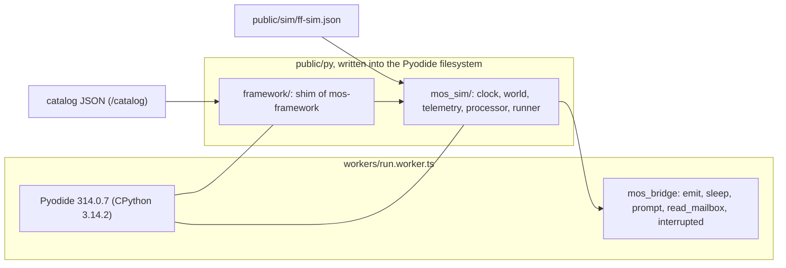

**Framework shim** (`public/py/framework/`): same module paths and public API as `mos-framework`, so real procedures
paste in unchanged.

| Module | Behaviour |
|---|---|
| `framework.ff.commands`, `.parameters`, `framework.jtyu.*` | Lazy, catalog-backed modules via PEP 562 module `__getattr__` (`framework/_catalog.py`). Classes are built with `type()` on first access and cached; enums are real `enum.Enum` subclasses with the real member names and values |
| `framework.mdb.super_class` | `SuperCommand` / `SuperParameter` with the same public method names, signatures, return tuples and prompt choice strings (`1: Retry command`, `2: Continue rest of the procedure`, ... `5: Stop execution`). YAMCS calls go to `mos_sim`; `inquirer.prompt` becomes `_ask` -> UI prompt; pydantic is replaced by a small coercion layer that raises a `ValidationError` look-alike |
| `framework.utils.log_helper` | `run_logger`, `extra_logger`, `csv_logger` route to the UI console |
| `framework.utils.custom_exceptions` | `SkipProcedureError`, `ChooseProcedureError`, `StopExecutionError`, mapped to run outcomes `skipped`, `choose`, `stopped` |
| `framework.settings`, `framework.utils.commanding` | Settings object (`MISSION`, `INSTANCE`, `ENVIRONMENT='sandbox'`, ...) and `create_utc_time` |

**Mock spacecraft** (`public/py/mos_sim/`, configured by `public/sim/ff-sim.json`, documented in `public/sim/README.md`,
schema `public/sim/sim.schema.json`):

| Piece | What it does |
|---|---|
| Virtual clock (`clock.py`) | `time.sleep`, `time.time`, `datetime.now` inside procedures use virtual time; real wait = virtual / warp (1x, 10x, 100x, instant). Scheduled events fire in order while the clock advances |
| Telemetry store (`telemetry.py`) | Parameters seeded from catalog defaults and the sim file's `initial`; sampled by `cadence`; latest vs fresh reads like the real framework; at most 4 telemetry snapshots per second go to the inspector |
| Command effects (`world.py`, `processor.py`) | `effects[]` in the sim file map a command (qualified name, class name or glob) and optional `when` args to parameter updates (`set` with literal, `add`, `fromArg`, `expr`) and delayed follow-ups. Commands without an effect complete after a latency drawn from a seeded RNG (0.4 to 1.2 virtual seconds) |
| Faults | `command_fails`, `command_timeout` (match by substring, once or always), `freeze_param`, `drop_param`. Toggle live during a run |
| Inspector | Edit any telemetry value mid-run; overrides are remembered and re-applied on the next run |

### SharedArrayBuffer protocol (blocking sleep, prompts, interrupt)

Python blocks the worker thread while a procedure runs, so the UI cannot `postMessage` to it. Control goes through
shared memory (`lib/sandbox/types.ts`, `lib/sandbox/run-client.ts`, `workers/run.worker.ts`):

| Buffer | Size | Use |
|---|---|---|
| `interrupt` | 1 byte used | UI writes `2` (SIGINT); also wired to `pyodide.setInterruptBuffer`, so Python raises `KeyboardInterrupt` -> outcome `stopped` |
| `ctl` (Int32 x 4) | 16 bytes | `PROMPT` (0 = none, else choice index + 1), `LOCK` (spin lock), `MAIL_LEN`, `SLEEP` (an address nothing ever notifies, used as an `Atomics.wait` target) |
| `mailbox` | 256 KB | Newline-delimited JSON control messages while running: telemetry overrides, fault list, warp changes |

Blocking `sleep` waits in 50 ms slices and checks the interrupt byte. `prompt` posts the event, flushes, then
`Atomics.wait`s on `ctl[PROMPT]` until the UI stores an answer and notifies. If the worker ignores Stop for 1.5 s
(`STOP_GRACE_MS`) the client terminates and restarts it. `SharedArrayBuffer` exists only in cross-origin-isolated pages,
hence `Cross-Origin-Opener-Policy: same-origin` + `Cross-Origin-Embedder-Policy: require-corp` on every response
(`next.config.ts`), and **no CDN loads at runtime**. `RunClient.ensureReady` fails with a clear message if
`crossOriginIsolated` is false.

### Sequence: dry run with an injected fault and the Retry prompt

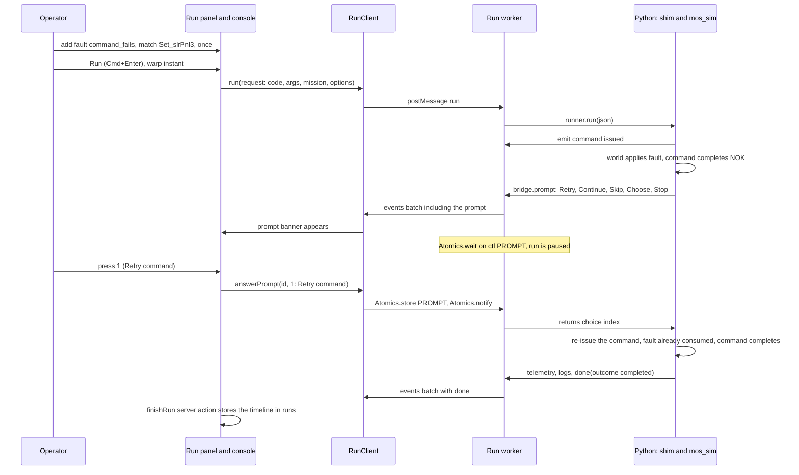

### Where the bytes come from (no CDN)

`scripts/vendor-assets.ts` (run by `postinstall` and `npm run vendor`; idempotent) populates `public/vendor/`
(gitignored, served with `Cache-Control: public, max-age=31536000, immutable` by `next.config.ts`):

| Asset | Source | Raw size | Brotli (measured locally) | Loaded by |
|---|---|---|---|---|
| `pyodide.asm.wasm` | `node_modules/pyodide` | 9.6 MB | 2.77 MB | both workers |
| `python_stdlib.zip` | same | 2.5 MB | 2.49 MB | both workers |
| `pyodide.asm.mjs`, `pyodide.mjs`, lock file | same | 1.3 MB | 0.24 MB | both workers |
| `jedi`, `parso` wheels | downloaded once from the Pyodide CDN at **install time**, sha256-verified against `pyodide-lock.json` | 1.67 MB | 1.30 MB | lang worker |
| Ruff `ruff_wasm_bg.wasm` + JS | `node_modules/@astral-sh/ruff-wasm-web` (`scripts/vendor-ruff.ts`) | 11 MB | 2.62 MB (gzip 3.8 MB) | lang worker |
| Monaco `min/vs` | `node_modules/monaco-editor` | about 25 MB on disk, loaded piecemeal | n/a | editor (`components/mos/code/monaco-loader.ts`) |
| `public/py/**` shim, sim, lint | repo | 224 KB on disk | about 30 KB | both workers (fetched with `?v=<manifest hash>`) |
| `public/catalog/ff.json` | repo | 1.79 MB | 89 KB | main thread and run worker |

Cold start for a first-time user: Pyodide core is about **5.5 MB brotli**; full intelligence adds Ruff (about 2.6 MB)
and jedi (about 1.3 MB), roughly 9 to 10 MB in total, then everything is cached (`immutable`). Each tab holds **two**
Pyodide instances (lang worker and run worker), each with its own WebAssembly heap (memory not measured here).
Transfer sizes depend on what the host compresses; the figures above compress the files locally.

---

## 8. Feasibility for production: lean embedded IDE vs a coupled VS Code

> The comparison of external products below is an assessment made while planning this prototype, not something the
> repository demonstrates. Verify licences and extension availability before committing to a production design.
> Figures for option B are planning estimates, not measurements.

| Criterion | **A. Monaco + Pyodide in the browser (this prototype)** | **B. code-server / openvscode-server per user in containers** | **C. VS Code for the Web build** |
|---|---|---|---|
| Setup complexity | One Next.js app plus static assets (`npm install`) | Orchestrator (k8s or similar), per-user volumes, auth proxy, image builds, extension management | Host the web build, build/curate extensions that work in a browser extension host |
| Per-user server cost | About zero: static files, cached after first load | Roughly 1 to 3 GB RAM and 1 to 2 vCPU per active user plus storage (estimate) | About zero |
| Performance and cold start | About 9 to 10 MB first load (section 7), instant afterwards; editor latency is local | Container start (seconds to minutes), network latency on every keystroke feature | Web-build download plus extension host start |
| Python intelligence | Catalog-aware providers (exact for MDB) + jedi + Ruff; basedpyright browser worker is a possible upgrade | Full Python tooling, but Pylance is licensed for Microsoft's VS Code builds only; alternatives such as basedpyright via Open VSX | No production-ready, supported Python language server for the web extension host that we could rely on at planning time |
| MOS-specific UX (submit, review, state, catalog, prompts) | Native React in one app; the IDE shares auth, data and components with the lifecycle UI | A separate VS Code extension codebase inside an iframe, with its own auth and messaging | Same as B |
| Sandboxing | WASM per tab; nothing runs on servers; the user's own browser is the sandbox | Container per user with a real shell and network (must be locked down) | Browser sandbox, but still needs a runtime for Python |
| Offline / air-gapped | All assets are same-origin static files; works once cached or served locally | Needs the cluster | Possible, with extensions pre-bundled |
| Maintenance | Own the editor wiring (about 7,300 lines in `lib/editor`, `lib/ide`, `lib/sandbox`, `workers`) | Track VS Code and extension updates and a fleet of containers | Track VS Code web builds and extension compatibility |
| Fidelity to real execution | Mock spacecraft only: a dry run is not a flight rehearsal | Can execute the real framework in the container | Needs a server runtime |

**Verdict.** A is the leanest option that can reach production for this use case: the product value is the lifecycle
(freeze, review, test, approve, audit), the editor only needs MDB-aware assistance and a fast dry run, and both fit in a
browser. B or C only pay off if operators need a full general-purpose IDE, which the PRDs do not ask for.

**What production would add**

| Addition | Why |
|---|---|
| Server-side **execution service** for real runs (MCS, flatsat, Bifrost) | Evidence from a browser is client-reported (section 10); real runs belong to an audited service. Section 9 prototypes this pattern |
| **basedpyright** in a browser worker | Type-aware Python intelligence beyond jedi (upgrade path, not required today) |
| **Shared helper libraries as versioned entities** | MOS005 currently forbids cross-procedure and helper imports; operators will want shared code that is itself reviewed, versioned and pinned per snapshot |
| **Per-environment deployment** (DEV, TEST on the PROD build, PROD) | PRD-002: TEST must run the PROD MOS build; the prototype is one deployment |
| SSO and a real role source | Roles are a column on `profiles` here |
| Notifications and impact analysis | Out of scope in PRD-001 (stale work, scheduled sheets) |

---

## 9. Bifrost (optional Jatayu target)

> **Status: complete.** Runner, API routes, client, IDE run target and seed procedures are all in the repository. The
> target is available in the IDE when the procedure's mission is `JTYU` and `BIFROST_ENABLED=true`
> (`BIFROST_TARGET` in `components/mos/ide-bifrost/target.ts`, registered in `lib/ide/run-targets.ts`).

**What Bifrost is.** A simulation platform (live at `bifrost.pixxel.space`, reachable over the Pixxel VPN) that runs
software-in-the-loop simulations (SILS) and gives each simulation its own YAMCS instance. Facts visible in the code:
REST at `/api/v1/workspaces/<workspace>` with a bearer workspace token (`lib/bifrost/client.ts`); per-run YAMCS at
`/yamcs/<workspace>-<sim_id>` with **no authentication** (`yamcsGet` comment); no CORS, so the browser cannot call it
directly.

**Why only Jatayu.** Bifrost's SILS simulates the Jatayu flight software with the `/jTYU/` MDB and instance `jtyu`;
Firefly procedures use `/FF/` and cannot run there. This is enforced three times: the run route returns 400 unless the
procedure's mission is `JTYU` (`app/api/bifrost/runs/route.ts`), the runner only allows `framework.jtyu.*` imports
(`runner/mos_runner/guard.py`), and the target is unavailable for FF procedures in the UI.

### Design

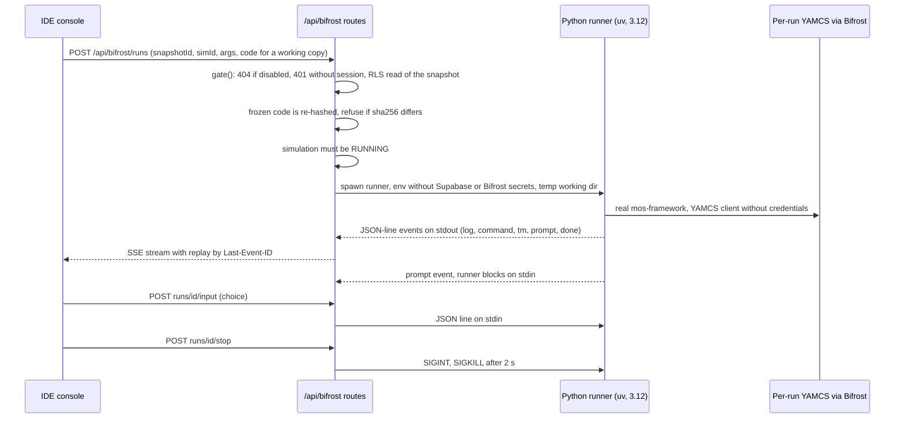

| Piece | Files | Notes |
|---|---|---|
| Runner | `runner/mos_runner/` (`main.py`, `instrument.py`, `guard.py`, `events.py`, `convert.py`, `entry.py`, `genmdb.py`), `runner/pyproject.toml`, `runner/uv.lock` | uv project on Python 3.12 with pinned deps (pydantic 2.6.1, yamcs-client 1.10.0, inquirer 3.1.4, ...). Uses a **copy** of mos-framework at `runner/.work/mos-framework` (gitignored; the original repo is never modified). Nothing in mos-framework is edited. `main.py` sets the settings the framework expects as `""` instead of `None` (`WDS_*`, `SLACK_BOT_TOKEN`, empty YAMCS username). `instrument.py` patches the imported framework in memory: no-credentials YAMCS client (`credentials=None`, Bifrost's YAMCS is open), `inquirer.prompt` -> JSON prompt event + stdin read, `realtime_processor` and `conn` wrapped to emit `command` and `tm` events, handlers attached to `run_logger`/`extra_logger`. `genmdb.py` applies four textual substitutions in memory so the framework's FF-hard-coded generators emit `jtyu`. Runs inside a temp directory because the framework creates log directories on import |
| Event contract | `lib/sandbox/types.ts` `RunEvent` | Same shapes as the in-browser run worker, so the console, timeline and prompt UI are shared |
| IDE run target | `lib/ide/run-targets.ts` (`BIFROST_TARGET`), `lib/sandbox/bifrost-run.ts` (implements `ProcedureRunApi` over `POST /api/bifrost/runs` + SSE), `lib/sandbox/bifrost-selection.ts` (attached sim, per tab in `sessionStorage`), `components/mos/ide-bifrost/` (`bifrost-panel.tsx` sim picker: list, attach, start, stop; mounted in the run panel through `RunTarget.Panel`) | Warp, faults and the inspector are off for this target (`capabilities`); real time only |
| Server registry | `lib/bifrost/runs.ts` | In-memory (`globalThis.__bifrostRuns`), buffers up to 20,000 events for replay, keeps finished runs 10 minutes, one active run per user |
| Bifrost client | `lib/bifrost/client.ts`, `types.ts`, `sim-config.short.yml` | List/get/start/stop sims, override manifest, failure injection, FSW parameter reads, direct YAMCS GET. Token read from env on every call, never sent to the browser |
| Routes | `app/api/bifrost/sims`, `sims/[simId]` (+ `stop`, `params`, `failures`, `override-manifest`), `runs`, `runs/[runId]/{stream,input,stop}` | All start with `gate()` (`lib/bifrost/guard.ts`): disabled -> 404 so the feature is invisible |
| Setup and scripts | `bifrost:setup`, `bifrost:gen-mdb`, `bifrost:seed` (`scripts/seed-jtyu.ts`), `bifrost:test`, `bifrost:sim` (`scripts/bifrost-*.ts`), `scripts/bifrost-test-http.ts` | `gen-mdb` generates the Jatayu TM/TC library from a RUNNING sim's MDB and rebuilds `public/catalog/jtyu.json` (1,183 commands, 1,997 parameters; subsystems grouped, mission-root items under "Common"). `bifrost:seed` adds the 3 procedures in `seed/procedures/jtyu/`. `bifrost:test` runs them on a live sim; `scripts/bifrost-test-http.ts` exercises the `/api/bifrost` routes of a running dev server as a demo persona |
| Data | `runs.target = 'bifrost'` | `runs.bifrost_sim_id` exists but is not filled yet |

Requirements: VPN, `BIFROST_ENABLED=true`, workspace and token, `uv` (Homebrew), a RUNNING simulation.

**Live verification (2026-10-22, reported by the lead; not re-run for this document).** Workspace `hrijul`, sim `2026-10-22T00:14:14Z`, FSW `jtyu-v15.0.3`, real time, started by us because none was running and stopped afterwards.

| Procedure | Result |
|---|---|
| `JTYU_SYS_001` ping and TC counters | completed in 3.5 s |
| `JTYU_SYS_002` housekeeping check | completed in 53 s with an injected override fault (EPS satbus voltage forced to 20.0 V for 150 s) that raised the real framework operator prompt, answered "2: Continue" over the prompt channel |
| `JTYU_THM_003` heater 3 toggle | completed in 34 s (Off) and 145 s (On), verified against `Htr3_Ctrl_St` |

HTTP route checks: 401 unauthenticated, 400 bad id, frozen code always loaded from storage (client-supplied code is ignored; only the author's own `in_progress` working copy may send its buffer), 409 for a concurrent run, prompt answer via `/input`, `/stop` ends the run as `stopped`, every route 404 when `BIFROST_ENABLED=false`.

Findings: Jatayu ack flags are an aggregate (dict), so FF's `PusAckFlagsEnum` pattern does not apply (the new-procedure template omits it for JTYU, `lib/procedure-template.ts`); `read_parameter_until_range` returns a 2-tuple after "Continue".

**Limitations:** real time only; Jatayu only; per-run YAMCS unauthenticated; one active run per user; in-memory run registry (lost on Next restart); a stopped run can leave the spacecraft mid-procedure; `runs.bifrost_sim_id` not filled; the runner's import/call allowlist (`runner/mos_runner/guard.py`) is defence in depth, **not a sandbox**: it executes operator Python on the host.

---

## 10. Security model

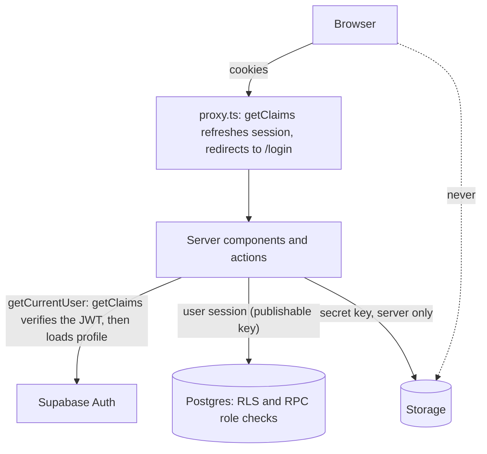

| Control | Implementation |
|---|---|
| Authentication | Supabase Auth (email + password). `proxy.ts` (Next 16 replacement for middleware) builds a server client from cookies and calls `getClaims()` to refresh the session; unauthenticated requests are redirected to `/login` (except `/login`, `/auth`; `/api/*` is left to the handlers, which check themselves). Matcher skips static assets, `/vendor`, `/py`, `/catalog`, `/sim` |
| Identity in code | `lib/auth.ts` `getCurrentUser()`: `getClaims()` verifies the JWT, then loads `profiles`. Redirects to `/login` if absent. Every server action calls it first |
| Roles | Stored in `profiles.roles`, read from the database on each call (not from the JWT), so changes apply immediately and cannot be stale. Enforced **inside the RPCs** (`private.has_role` / `require_role`); `lib/lifecycle.ts` only decides which buttons to show |
| Server actions re-check | Actions never trust UI state: `saveDraft` and `submitSnapshot` re-read the snapshot through RLS and compare `author_id`/`state`; lifecycle moves are re-validated by `transition_snapshot` |
| Secrets | `SUPABASE_SECRET_KEY` is read only in `lib/supabase/admin.ts` (`import "server-only"`). `DEMO_PASSWORD` is used only in the `signInAsPersona` server action. `.env*` is gitignored except `.env.example` |
| Storage | Private bucket, no `storage.objects` policies, accessed only by the server via the secret key after a permission check |
| Database | RLS enabled on every table; `authenticated` read-only except three narrow tables; `anon` has nothing; DML revoked as defence in depth; all RPCs `search_path = ''`; execute revoked from `public`/`anon` |
| Browser isolation | COOP/COEP on every response. Python runs in WebAssembly in a Web Worker: no file system, no network access to the host, no process spawning |
| Import allowlist | MOS005 in the editor and the same allowlist re-checked by the Bifrost runner guard |
| Bifrost | Feature-gated (404 when disabled), session required, runs scoped to their owner, runner process gets a stripped environment (no Supabase or Bifrost secrets) |

**What is NOT production-grade yet**

| Gap | Detail |
|---|---|
| Demo personas | `DEMO_MODE=true` shows one-click login and a persona switcher backed by a shared password. Must be off in any real deployment |
| Run evidence is client-reported | `runs` rows and their `events` are written by the browser (RLS only checks `started_by`); a tester could fabricate evidence, and `test_records.run_id` is not checked to belong to the same snapshot. PRD-001 accepts "MOS takes their word" for v1; production needs execution evidence generated by a trusted service |
| Everything is readable by every signed-in user | Including other authors' working copies (server reads any snapshot the RLS session can see) |
| Review comments are mutable | `update` is granted on `review_comments` with a policy but without column limits, so a comment body can be edited by its author (or any reviewer); unlike transitions it is not append-only |
| No rate limiting, no CSP, no audit of reads | Not built |
| Bifrost runner is not a sandbox | Executes operator Python as the dev server's OS user; guard is a static filter |
| Bifrost token on the server only, but YAMCS is unauthenticated | Anyone on the VPN can talk to a per-run YAMCS directly |
| Single Supabase project, no backups, no retention policy | `runs.events` can grow |
| Roles are a table column | No SSO / group mapping |

---

## 11. Tech stack and dependencies

Versions are from `package.json` (ranges) and `node_modules` (installed).

### Runtime dependencies

| Package | Version | Why |
|---|---|---|
| `next` | 16.4.2 | App Router, server actions, route handlers, `proxy.ts`, `cacheComponents`, Turbopack. This Next has breaking changes; see `AGENTS.md` and `node_modules/next/dist/docs/` |
| `react`, `react-dom` | 19.3.0 | UI (uses `<Activity>`, so Monaco wiring is idempotent) |
| `@supabase/supabase-js` | ^2.118.0 | Postgres RPC/queries, Storage (server), Realtime, Auth admin (seed) |
| `@supabase/ssr` | ^0.12.7 | Cookie-based server/browser clients and `proxy.ts` session refresh |
| `monaco-editor` | ^0.57.0 | Editor and diff editor; `min/vs` is copied to `/vendor/monaco/vs` |
| `@monaco-editor/react` | ^4.7.0 | React wrapper; loader pointed at `/vendor/monaco/vs` (no CDN) |
| `pyodide` | ^314.0.7 | CPython 3.14.2 compiled to WASM: run worker and lang worker |
| `@astral-sh/ruff-wasm-web` | ^0.17.1 | Ruff lint and format in the browser |
| `radix-ui` | ^1.8.1 | Accessible primitives under shadcn/ui |
| `class-variance-authority` | ^0.7.1 | Component variants (shadcn/ui) |
| `cn` | ^0.5.0 | `cn()` class merge helper (`lib/utils.ts` re-exports it) |
| `lucide-react` | ^1.61.0 | Icons |
| `motion` | ^14.5.0 | Subtle layout and entrance animation, respects reduced motion |
| `cmdk` | ^1.1.1 | Command palette and searchable pickers |
| `sonner` | ^2.0.8 | Toasts for action results |
| `next-themes` | ^0.4.6 | Dark default, light toggle |
| `nuqs` | ^2.10.2 | Filters and tabs in the URL (client and server parsers) |
| `react-resizable-panels` | ^4.14.8 | IDE and run-workbench layout |
| `date-fns` | ^4.4.0 | Relative and absolute times |
| `diff` | ^9.0.0 | Line diff statistics (`components/mos/code/diff-stats.ts`) |
| `server-only` | ^0.0.1 | Fails the build if server modules are imported into client code |
| `shadcn` | ^4.22.1 | Component generator; app CSS imports `shadcn/tailwind.css` |
| `tw-animate-css` | ^1.4.0 | Animations for shadcn components |

### Dev dependencies

| Package | Why |
|---|---|
| `typescript` ^5, `@types/node` ^24, `@types/react*` | Strict TypeScript |
| `tailwindcss` ^4, `@tailwindcss/turbopack` ^4 | Styling; the Turbopack loader rule is in `next.config.ts` |
| `eslint` ^9, `eslint-config-next` 16.4.2 | `npm run lint` |
| `vitest` ^5.0.5 | Unit tests (`npm test`) |
| `tsx` ^4.23.15 | Runs the TypeScript scripts (`scripts/*.ts`) |
| `postgres` ^3.4.9 | Direct SQL for `db:setup`, `db:drop`, `db:test`, seeds |
| `dotenv` ^18.0.8 | Loads `.env.local` in scripts |

### Local tools

| Tool | Needed for |
|---|---|
| Node.js >= 20.9 (Next's engine requirement; vitest 5 needs 22.12+, 24 or 26+; developed on Node 26) and npm | Everything |
| A Supabase project | Auth, Postgres, Storage, Realtime |
| `python3` (stdlib only) | `npm run catalog:build`, `python3 scripts/test_mos_lint.py` |
| `uv` (Homebrew) | **Only** the optional Bifrost runner (manages Python 3.12 and `runner/.venv`) |
| Docker | Not used |

---

## 12. Repository map

```
mos-prototype/
├── app/
│   ├── layout.tsx, globals.css        root layout, theme tokens
│   ├── login/                         email/password + persona grid, server actions (sign in/out)
│   ├── (app)/                         authenticated shell (sidebar, command palette, live refresh)
│   │   ├── page.tsx, _home/           "My queue": what needs me, PROD at a glance
│   │   ├── procedures/                list, procedure page (PROD lane, lineage, timeline)
│   │   ├── snapshots/                 explorer table; [id] viewer with Code/Review/Test/Approval/History tabs
│   │   │   └── [id]/edit, [id]/run    the IDE; the frozen-snapshot dry-run page
│   │   ├── catalog/                   TM/TC browser
│   │   ├── audit/                     audit log, CSV export, incident lookup
│   │   └── admin/                     roles, allow-self-actions switch
│   ├── actions/                       server actions: lifecycle.ts (RPC + storage), collab.ts (comments, tests, runs, roles)
│   └── api/                           audit/export, runs/[id], bifrost/**
├── components/
│   ├── ui/                            shadcn/ui primitives
│   └── mos/                           app components: ide/**, code/** (Monaco), procedure/**, tables/**, state-badge, ...
├── lib/
│   ├── supabase/                      server (cookies), browser, admin (secret key) clients
│   ├── lifecycle.ts, auth.ts          state/action metadata and current user
│   ├── storage.ts                     bucket access, sha256, frozen paths, verified reads
│   ├── data/                          server queries and row types
│   ├── catalog/                       catalog types and loader
│   ├── editor/                        catalog intellisense, lang client/protocol, Python language features, Ruff settings
│   ├── ide/                           autosave queue, args form model, run targets, Monaco wiring, local storage
│   ├── sandbox/                       run worker client, hook, shared types
│   └── bifrost/                       Bifrost REST client, run registry, route guard (server only)
├── workers/                           lang.worker.ts, run.worker.ts
├── public/
│   ├── py/                            framework shim, mos_sim, mos_lint, manifest.json (hash)
│   ├── catalog/                       ff.json, jtyu.json
│   ├── sim/                           ff-sim.json, README, JSON schema
│   └── vendor/                        GENERATED, gitignored: pyodide, monaco, ruff
├── supabase/migrations/               schema, RPCs, RLS, grants, bucket, realtime
├── seed/                              manifest of 20 FF procedures + histories, replay/validate/DDL helpers, procedure sources
├── scripts/                           vendor, db-setup/seed/drop/test, test-runtime/seeds, build_catalog.py, bifrost-*
├── runner/                            optional Python 3.12 Bifrost runner (uv project)
├── prds/                              PRD-001 lifecycle, PRD-002 workspaces, entity model
├── proxy.ts                           session refresh and login redirect
└── next.config.ts                     COOP/COEP headers, immutable cache for /vendor, cacheComponents, Turbopack CSS rule
```

---

## 13. Testing

| Command | What it runs | What it proves | Last run while writing this doc |
|---|---|---|---|
| `npm test` | Vitest, 12 files | Catalog loading and real-catalog invariants, catalog intellisense (completions, diagnostics, quick fixes), arg-form model, console model, autosave queue (coalescing, retry), outline, refs, snippets, the language stack in Node (Ruff WASM, `mos_lint` and jedi on Pyodide; Pyodide cases skip if `public/vendor` is missing), and `computeProdHistory` (supersede, rollback, withdraw and retire windows) | 12 files, 95 tests passed |
| `npm run test:runtime` | `scripts/test-runtime.ts`: the shim and mock spacecraft in Node (Pyodide from `node_modules`) | Signature inspection, green paths of two real procedures, `command_fails` -> Retry prompt, `command_timeout`, freeze/drop faults, argument coercion, virtual clock, stdout, stop/mailbox/warp, sim effects | 55 checks passed |
| `npm run test:seeds` | `scripts/test-seeds.ts`, offline (no database) | Every seed procedure (latest and historical) passes the MOS checker, uses only commands that exist in the FF catalog, and **runs to `completed` on the mock spacecraft**; the seed history replays through the lifecycle rules and satisfies the database invariants; storylines and per-persona queues exist | 426 checks passed |
| `python3 scripts/test_mos_lint.py` | `unittest` on `public/py/mos_lint/check.py` | MOS000 to MOS009 behaviour, entry-point/signature extraction, a real procedure has no errors | 17 tests OK |
| `npm run db:test` | `scripts/db-test.ts` against the configured Supabase project; each scenario in a rolled-back transaction impersonating users via `request.jwt.claims` | PRD-001 acceptance A1-A15 and A17 through the real RPCs, plus: separation of duties, role enforcement and comment requirements, the one-approved index against direct writes, append-only audit tables and refused client writes, refusal of a frozen path the server did not write, and a **real concurrency race** (two approvers, one procedure: exactly one approved). Includes a two-connection concurrency race | 19 of 19 passing (run by the lead on 2026-10-22 against the seeded project) |
| `npm run bifrost:test` | Live end-to-end on a Bifrost sim (VPN, token, `bifrost:setup`) | Seed Jatayu procedures run through the real runner, including one injected fault | Passed on a live sim (lead, 2026-10-22), see section 9 |
| `npm run lint`, `npm run build` | ESLint, Next production build | Static quality gates | Clean (lead); the production build was verified to run procedures in the browser (Pyodide workers work under `next start`) |

Acceptance mapping (`prds/procedure-lifecycle-states.md` section 13): A1 to A15 and A17 are covered by `db:test`.
A16 (sequences of events) and A18 (repository merges) have no counterpart because sequences do not exist in the
prototype and there is no repository to merge in.

---

## 14. Known limitations and next steps

| Area | Limitation | Next step |
|---|---|---|
| Execution fidelity | Dry runs hit a mock spacecraft; sim effects cover the telemetry the seed procedures touch; other commands just acknowledge after a latency. A green dry run does not prove flight behaviour | Execution service against real MCS / flatsat / Bifrost (section 9 is the pattern) |
| Evidence | Client-reported run records (section 10) | Evidence produced by a trusted runner and stored with a hash |
| Bifrost | Jatayu only, real-time, unauthenticated YAMCS, runner is not a sandbox, one active run per user, in-memory run registry | Isolate the runner (container or jail), persist runs, fill `runs.bifrost_sim_id` |
| Python intelligence | jedi cannot see the generated classes (the catalog providers fill that gap); no cross-file analysis | basedpyright worker |
| Shared code | MOS005 bans helper imports (`utils`, `src`, `ops`, ...) | Versioned shared libraries pinned per snapshot |
| Environments | One deployment; DEV/TEST/PROD are views over snapshot state (`STATE_META[...].env`), not separate stacks | Per-environment deployment with TEST on the PROD build |
| Lifecycle scope | No sequences of events, impact analysis or notifications (PRD non-goals) | Follow the PRDs |
| Roles and auth | Roles in a table; demo personas | SSO, role mapping, per-transition permission matrix |
| Browser support | Needs cross-origin isolation, module workers and SharedArrayBuffer; developed and checked in a Chromium-based pane; other browsers not verified | Browser matrix |
| Resource use | Two Pyodide instances per tab; large first download (about 9 to 10 MB brotli) | Share one Pyodide where possible; preload hints |
| Data hygiene | `runs.events` retained indefinitely (last 3000 events per run); `db:seed` wipes demo tables | Retention policy; never point `db:seed` at real data |
| Catalog freshness | Catalog is generated from a mos-framework checkout (`scripts/build_catalog.py`); FF catalog dated 2026-04-21 | Build it in CI from the framework release, version it with the MDB |
