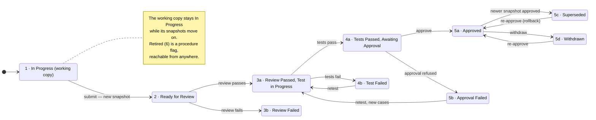

# Procedure lifecycle states

## 1. Summary

A procedure is written in a working copy. Submitting it freezes a **snapshot**,
and the snapshot is what moves through review, testing and approval. Each
snapshot sits in exactly one state. A procedure may have several snapshots at
once — one approved and running, one in review, and a working copy still being
edited — but never more than one approved. Each move is an action a person
takes, and MOS records who took it and when.

This gives us the gates that do not exist today, and the audit trail that
LEO-077 asks for.

## 2. User problem

Code review has a home: a pull request stops unreviewed changes reaching the
repository. Everything after code review has no home. A procedure is cleared
for flight by being reviewed, then tested, then signed off — and only the first
of those leaves a trace.

| Today | What it costs |
|---|---|
| Testing happens on the simulator, outside the repository. Nothing records that a procedure was tested, by whom, or which version. | A procedure can be merged and flown without anyone running it. |
| A PR collects approvals in any order. | Sign-off can come before testing. Nothing stops it. |
| A failed test or a refused sign-off ends as a closed PR. | The failure is lost. Months later nobody can say whether a procedure ever failed. |
| To know if a procedure is cleared for flight, an operator must read GitHub branches and PRs. | Under time pressure, a misread means trusting the wrong version. |
| A PR is open or merged — nothing in between. | A planner building tomorrow's sheet cannot tell a procedure one click from approval from one barely started. |
| Taking a flown procedure out of use means a revert PR through the full flow. | Withdrawing a bad procedure an hour before a pass is slow, when it most needs to be fast. |
| Work stalls without anyone noticing — reviewed but never tested, tested but never signed off. | Procedures sit half-done. |

**After an incident.** An investigation asks four questions: which version
ran, who reviewed it, who tested it, who cleared it for flight. Today nothing
records who tested it or who approved it.

## 3. Goals

1. Every snapshot is in one state, and only one. Every procedure has at most
   one approved snapshot.
2. The states together describe the whole life of a procedure — nothing
   happens to a procedure that the state set cannot express.
3. Every state change records who made it and when.
4. Failure is a state, not a comment somewhere. A failed review or a failed
   test is visible in any list of procedures.
5. Work never stops for the pipeline. An author keeps editing while a snapshot
   is in review.
6. Later gates and audits — what may run, what changed since approval — have
   something solid to hang off.

## 4. Non-goals

| Not in v1 | Why |
|---|---|
| Who may perform each transition | Role-based authorization PRD |
| Configurable workflow rules | GSS marked these skipped on LEO-077 |
| What runs in which environment, and the action buttons | Execution PRD and Procedure Workspaces and Environments PRD |
| What a review actually does | Execution PRD |
| How snapshots are stored, identified and rolled back | Version Management PRD |
| Automated test execution and test case management | **V2.** In v1 a tester records the outcome and MOS takes their word. |
| Review mechanics — diffs, comments | Procedure Workspaces and Environments PRD |
| A separate release step after approval | Parked. Approved means available in PROD. |
| Notifications when a state changes | Notification Service, later |
| Bulk state changes | No demand yet |
| Lifecycle states for a sequence of events | No requirement — OQ-049 |

## 5. User stories

- As an author, I want a new procedure to start as In Progress, so that nobody
  mistakes a draft for something usable.
- As an author, I want to submit a snapshot for review and keep editing, so
  that review does not stop my work.
- As a reviewer, I want to pass or fail a snapshot, so that the outcome is
  recorded rather than sent in a message.
- As a reviewer, I want a failed snapshot to stay failed, so that it cannot
  slip forward to testing.
- As a tester, I want to record a test failure, so that the snapshot stops
  there and the reason is visible.
- As a tester, I want to retest a failed snapshot without a new submission, so
  that a bad test setup does not force a pointless edit.
- As an approver, I want to approve a snapshot that has passed its tests, so
  that PROD can use it.
- As an approver, I want to refuse approval, so that the reason a snapshot
  stopped is recorded rather than passed on verbally.
- As an approver, I want to send a refused snapshot back for retesting, so
  that weak test coverage does not force a new submission.
- As an approver, I want to withdraw approval, so that a snapshot leaves PROD
  without the procedure being deleted.
- As an approver, I want to re-approve a superseded snapshot, so that I can
  roll back without a review cycle.
- As an operator, I want to see each procedure's approved snapshot and whether
  edits are pending, so that I know what I am looking at before I use it.
- As an operator, I want to retire a procedure that is no longer wanted, so
  that it stops being used without losing its history.

## 6. Scope for v1

In scope: the two-level state set, the allowed moves between states, the
one-approved-snapshot rule, and the record of who moved what and when. Both
requirements behind it are Accepted.

Out of scope, and why:

| Item | Status |
|---|---|
| Configurable workflow rules (part of LEO-077) | Marked skipped by GSS. Valid moves are fixed in code. |
| Per-transition permissions | Separate PRD. This PRD assumes they exist. |
| Release as a step after approval | Parked. Approved is the gate. |
| Automated test execution | V2. In v1 the tester moves the snapshot out of state 3a by hand. |

## 7. What it does

There are two things with state.

| Thing | What it is | Changes? |
|---|---|---|
| Working copy | where the author edits | constantly |
| Snapshot | the working copy frozen on submit | never |

The **procedure** has two states of its own. The **snapshot** has nine.

| # | State | On | Reached when |
|---|---|---|---|
| 1 | In Progress | procedure | a working copy with unsubmitted changes exists |
| 2 | Ready for Review | snapshot | the author submits |
| 3a | Review Passed, Test in Progress | snapshot | the reviewer passes it, or a retest starts |
| 3b | Review Failed | snapshot | the reviewer fails it |
| 4a | Tests Passed, Awaiting Approval | snapshot | the tester records a pass |
| 4b | Test Failed | snapshot | the tester records a failure |
| 5a | Approved | snapshot | the approver approves it — **now available in PROD** |
| 5b | Approval Failed | snapshot | the approver refuses it |
| 5c | Superseded | snapshot | a newer snapshot of the same procedure is approved |
| 5d | Withdrawn | snapshot | the approver removes approval |
| 6 | Retired | procedure | anyone with the right retires it |

Forward is a single path for a snapshot: 2 → 3a → 4a → 5a. No shortcuts.
Testing starts the moment review passes, so there is no separate "awaiting
test" state.

Top row is the happy path. Middle row is the three failures. Bottom right is
what happens to an approved snapshot afterwards.

Six rules are worth saying in words:

- **Submit makes a snapshot and leaves the working copy alone.** The author
  keeps editing. The next submit makes another snapshot.
- **A snapshot never changes.** A failed snapshot is finished — there is no
  route back to In Progress, because there is nothing to edit. The fix is a new
  snapshot from the working copy.
- **One approved snapshot per procedure.** Approving a new one moves the old
  one to Superseded, and PROD uses the new one from that moment. There is no
  separate release step.
- **Withdraw and Superseded are not dead ends.** An approver can re-approve
  either with no review cycle. That is rollback.
- **Editing is what creates state 1.** MOS does not mediate edits — it reacts
  to them. LEO-077 also restricts who may edit a validated procedure, which is
  a control on the store rather than on the lifecycle — OQ-058.
- **Retired is a procedure-level flag, not a snapshot state.** It blocks new
  use and takes the approved snapshot out of PROD. Snapshots keep their states,
  so restoring the procedure brings its approved snapshot back.

## 8. Requirements

| # | Requirement | Traces to | Who may |
|---|---|---|---|
| R1 | A snapshot shall be in exactly one state. A procedure shall have at most one snapshot in Approved | LEO-076, refined | — |
| R2 | The state set shall be the eleven states in section 7 | LEO-076, refined | — |
| R3 | Forward movement for a snapshot shall be 2 → 3a → 4a → 5a only | LEO-077 | the role owning each step |
| R4 | From 3b a snapshot shall not move | LEO-077 | — |
| R5 | From 4b a snapshot shall move only to 3a | LEO-077 | author, tester |
| R6 | From 5a a snapshot shall move only to 5c, when another snapshot of the procedure is approved, or 5d, when an approver withdraws | LEO-077 | approver |
| R6b | From 5b a snapshot shall move only to 3a | LEO-077 | approver |
| R6c | From 5c or 5d a snapshot shall move only to 5a, by an approver, with no review or test | LEO-077, refined | approver |
| R7 | A procedure shall be retirable from any state and restorable. A retired procedure's snapshots keep their states | LEO-076, refined | — |
| R8 | Every state change shall record the user, the time, the state left, the state entered and the snapshot | LEO-077 | — |
| R9 | The approved snapshot, and whether edits are pending, shall be shown wherever a procedure is listed | LEO-076 | any user |
| R10 | Editing shall change the working copy only. A state shall change only by a transition in section 7, made through MOS. No action outside MOS — on the repository or an environment — shall change any state | LEO-077, narrowed | author |
| R11 | Submit shall create a snapshot from the working copy and leave the working copy editable | LEO-076, refined | author |
| R12 | A procedure in any state shall be addable to a sequence of events | LEO-082 | any user |
| R13 | A sequence shall execute only procedures that have an Approved snapshot, resolved when the sequence starts (DEC-044). Enforcement is specified in the execution PRD | no requirement — see Dependencies | — |
| R14 | A retired procedure shall not be addable to a sequence of events | LEO-076, refined | — |

## 9. Domain items touched

| Item | Kind | Read / written | Held by |
|---|---|---|---|
| `Procedure` | entity | read; its In Progress / Retired flag written | MOS. How a procedure is identified — by its file path, which changes when the file moves, or by a stable ID that does not — is UNRESOLVED — OQ-060. |
| `ProcedureVersion` | entity — the snapshot | referenced; its state written | MOS |
| `StateTransition` | record | written | MOS |
| `User` | external reference | read | identity provider |
| `Role` | entity | read | identity provider or MOS — unresolved |
| `Permission` | value set | read | MOS |
| `SequenceOfEvents` | entity | read | MOS |
| `SequenceEntry` | entity | read | MOS |

Nothing new is introduced. `validated` stays a derived property (DEC-031,
DEC-040): a snapshot is validated when its state is Approved.

## 10. Dependencies

**Other features**

| Feature | What breaks without it |
|---|---|
| Role-based authorization | Anyone can make any move. The gates exist but do not hold. |
| Version Management | Defines what a snapshot is, how it is identified and stored. Without it "snapshot" here has no mechanism. |
| Procedure Workspaces and Environments | Defines where the working copy lives and what PROD reads. Without it "available in PROD" means nothing. |
| Execution — what runs, action buttons, what review does | R13 is stated here but enforced there. And the move from 2 to 3a or 3b works while nothing happens in between. |
| Impact and dependency analysis (DEC-026) | Approving a new snapshot changes what every scheduled sheet using the procedure will run. Nobody is warned. |

**External systems**

| System | What it gives us |
|---|---|
| Identity provider | Identifies the person making each move |
| Bifrost / FSW OBC simulator | Where testing actually happens. MOS records the outcome only, so nothing here integrates with it in v1. |

**Blocked on:** nothing. Both requirements are Accepted. LEO-099 (simulation)
and LEO-104 (multi-user visibility) are both On Hold and sit next to this
feature without blocking it — LEO-099 becomes a dependency only when test
automation is picked up in V2.

## 11. Edge cases and failure modes

| Case | Behaviour |
|---|---|
| Two people move the same snapshot at once | Unspecified. Needs a rule — first write wins, or a lock. Flagged in `registers/cross-cutting.md` as a gap across the whole system. |
| The working copy is edited while a snapshot is in review | No effect on the snapshot. That is the point of snapshots. |
| A new snapshot is approved while a sheet using the procedure is scheduled | The sheet runs the new snapshot when it starts. Impact analysis must highlight this — its PRD. |
| A new snapshot is approved, or the approved one withdrawn, while a sheet using the procedure is **running** | The sheet keeps the snapshot it started with, to the end (DEC-044). The change applies from the next sheet start. |
| The only approved snapshot is withdrawn while a sheet is scheduled | The sheet cannot run. Impact analysis must highlight this. |
| An approver refuses, then changes their mind | No direct route from 5b to 5a. The route is 5b → 3a → 4a → 5a. |
| The approver disputes the test cases, not the procedure | 5b → 3a. Testing runs again, no second review. |
| A procedure is retired while scheduled in a future sheet | The sheet cannot run. Impact analysis must highlight this. |
| A tester marks tests passed without running any | MOS cannot tell. It records who said so. An accepted limitation of v1, and the main thing test automation removes in V2. |
| A snapshot sits in 3b, 4b or 5b forever | Allowed. Nothing expires. Old snapshots are history, not clutter. |
| A procedure is retired, then restored | Its snapshots kept their states. The approved one is back in PROD. |

## 12. Open questions

| OQ | Question | Owner | Blocks |
|---|---|---|---|
| OQ-055 | Who creates a procedure's first state record, given authoring happens outside MOS? | tech-lead | The entry point into state 1 |
| OQ-058 | Who enforces the restriction on editing a validated procedure? | tech-lead | The second half of LEO-077. MOS cannot enforce it — it does not hold the files. |
| OQ-060 | Is a procedure identified by its file path or by a stable ID? | tech-lead | R1's "per procedure" needs a stable "procedure". |
| OQ-049 | Do sequences of events need lifecycle states too? | ops-team | Nothing here. Recorded so the asymmetry is deliberate. |

## 13. Acceptance criteria

| # | Given / when / then | Covers |
|---|---|---|
| A1 | Given a new procedure, when it is registered, then it is In Progress with no snapshots | R1, R2 |
| A2 | Given a working copy, when the author submits, then a snapshot exists in Ready for Review and the working copy is still editable | R11 |
| A3 | Given a snapshot in any state, when it is read, then exactly one state is returned | R1 |
| A4 | Given a snapshot in Review Failed, when any move is attempted, then it is refused | R4 |
| A5 | Given a snapshot in Test Failed, when a retest is started, then it is in Review Passed, Test in Progress and no new submission was needed | R5 |
| A6 | Given a snapshot in Test Failed, when a move to Approved is attempted, then it is refused | R5 |
| A7 | Given procedure P with snapshot B Approved, when snapshot A is approved, then A is Approved and B is Superseded | R1, R6 |
| A8 | Given procedure P with snapshot B Superseded, when an approver re-approves B, then B is Approved and the previously approved snapshot is Superseded | R6c |
| A9 | Given an approved snapshot, when the approver withdraws it, then it is Withdrawn and the procedure has no approved snapshot | R6 |
| A10 | Given a snapshot awaiting approval, when the approver refuses it, then it is Approval Failed | R2 |
| A11 | Given a snapshot in Approval Failed, when a move to Approved is attempted, then it is refused | R6b |
| A12 | Given a snapshot in Approval Failed, when the approver sends it back for retesting, then it is Review Passed, Test in Progress | R6b |
| A13 | Given any state change, when it completes, then a record exists with the user, the time, the state left, the state entered and the snapshot | R8 |
| A14 | Given a procedure in any state, when it is retired, then it is Retired and every snapshot keeps its state | R7 |
| A15 | Given a retired procedure with an approved snapshot, when it is restored, then that snapshot is available in PROD again | R7 |
| A16 | Given a retired procedure, when it is added to a sequence of events, then it is refused | R14 |
| A17 | Given a snapshot in review, when the working copy is edited, then the snapshot's state is unchanged | R10 |
| A18 | Given a snapshot in review, when its content is merged in the repository outside MOS, then no snapshot's state changes | R10 |

A4, A6, A11 and A16 test refusals. They cannot be fully tested until
per-transition permissions exist — see Dependencies.